

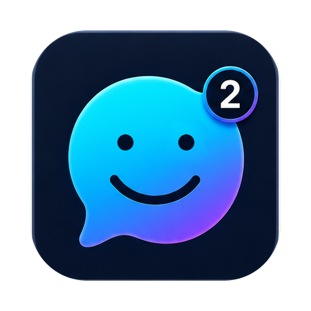

# X2Chat

**A private messenger that turned into a workspace.**
No phone number. No email. End-to-end encrypted chats, files and calls —
plus a wallet, notes, tasks, a calendar, an AI assistant and games, all inside one app.

[Download for Mac](https://x2chat.com/downloads/) · [App Store](https://apps.apple.com/app/id6759472435) · [Android APK](https://x2chat.com/downloads/x2chat-latest.apk) · [Security model](https://x2chat.com/security/) · [x2chat.com](https://x2chat.com)

---

## Your account is a key, not a phone number

Sign up and X2Chat generates a key pair on your device. That is your identity: a six-character ID and a key nobody else holds. No SIM, no email, no password to leak. Sign-in is a signed challenge — the server never learns a secret it could hand over.

## Everything is encrypted end to end

Every message gets its own AES-256-GCM key, wrapped separately for each of your devices. Files the same. Voice calls travel over our own QUIC transport written in Rust; video goes through WebRTC with encrypted frames, so relays forward ciphertext they cannot read. Verify a contact in person by QR and the app will refuse any later key substitution.

## And then it kept growing

X2Chat is no longer only a messenger. It is where a small team can actually work:

- **💬 Chats and groups** — replies, reactions, pinned messages, folders, archive, full-text search across your entire history, export to HTML, JSON or PDF with the files included.
- **📞 Calls** — one-to-one and group, audio and video, screen sharing, picture-in-picture, on phone and desktop alike.
- **🤖 AI assistant** — in a panel beside the conversation or in its own window. It reads the thread, understands photos, summarises, drafts replies, fixes your wording, translates, and turns "remind me Monday" into a real task.
- **👛 Wallet** — USDT on TRON, instant free transfers between X2Chat users, confirmed by PIN.
- **📝 Notes, tasks and a calendar** — one encrypted chat with yourself, synced across every device; tasks with reminders open straight from a chat.
- **🎮 Games** — solitaire and a shelf of offline games, plus chat quests you play with friends inside a conversation.
- **🧩 Mini apps** — a dock on the right edge: pin what you use, minimise, run several at once. Anyone can build one.
- **🛠 Bots** — a Telegram-compatible Bot API, so your automation moves in with you.
- **🌍 Seven languages**, light and dark, themes, and a Mac app that looks like it belongs on a Mac.

## One account, every device

iPhone, iPad, Android, Mac, Windows. Pair a device by QR; your keys never leave them. Messages, notes and tasks arrive everywhere.

## See it

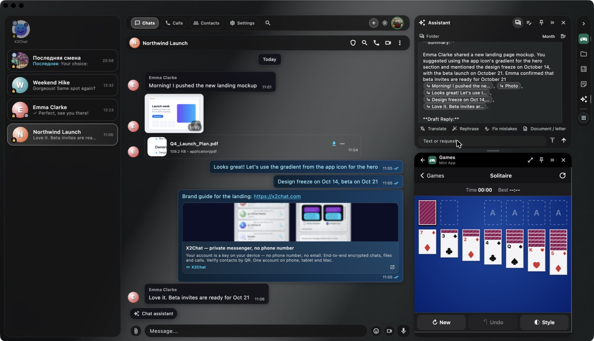

<b>One window, three things at once</b> — a conversation, the assistant working on it, and a game you never had to leave the app for.

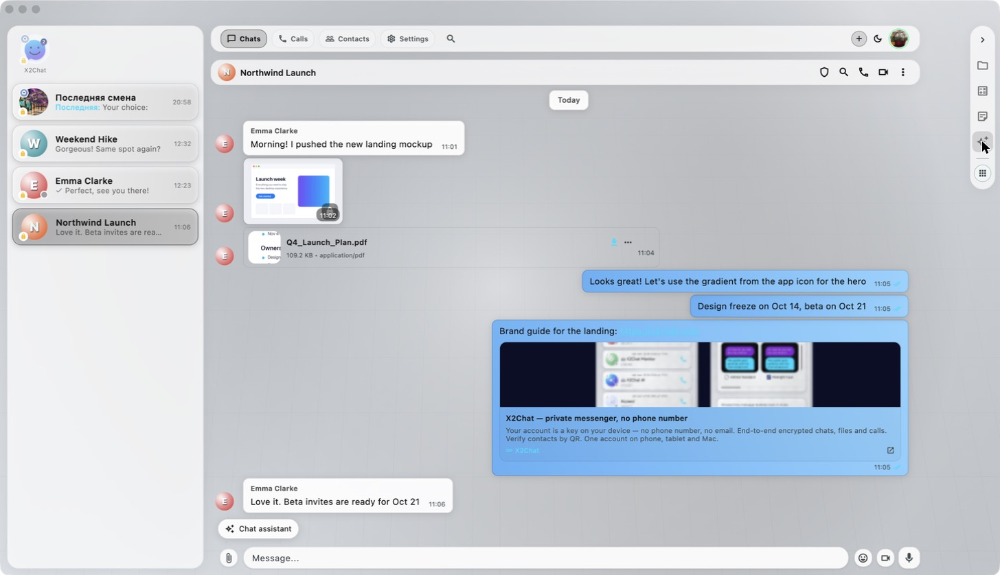

<b>Light or dark</b>, and a dozen ready-made themes on top.

| | |
|:--:|:--:|
| 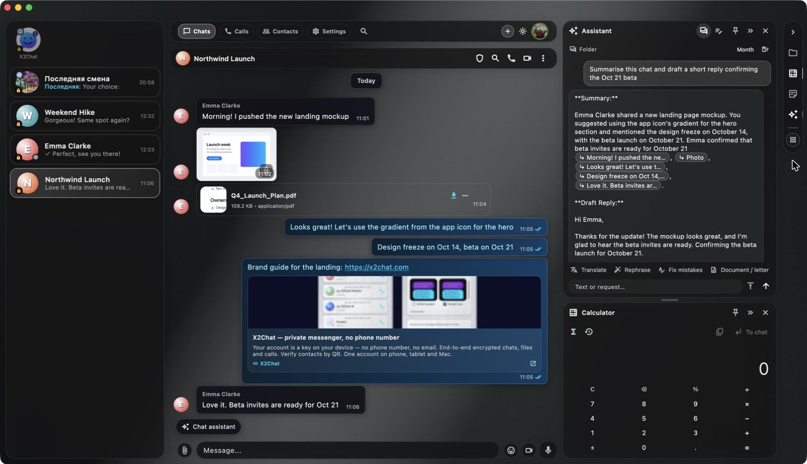 | 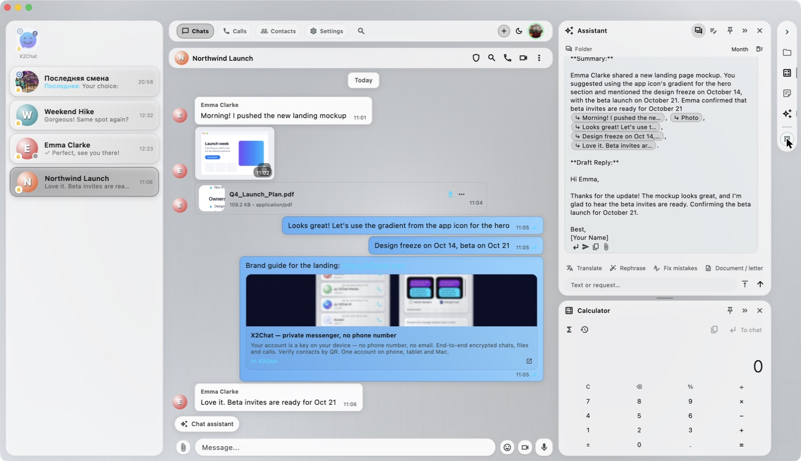 |
| **The assistant reads the thread** and answers with a summary, links to the exact messages, and a reply you can send as is. | **Same thing in light mode** — translate, rephrase, fix mistakes, or turn the thread into a document. |
| 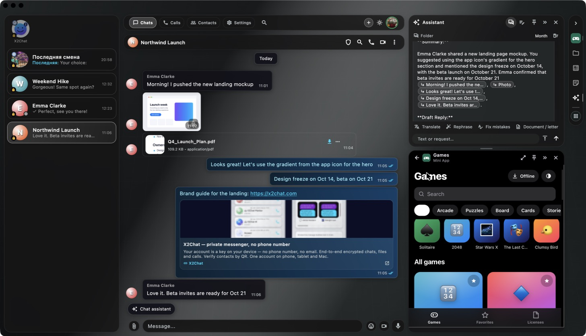 | 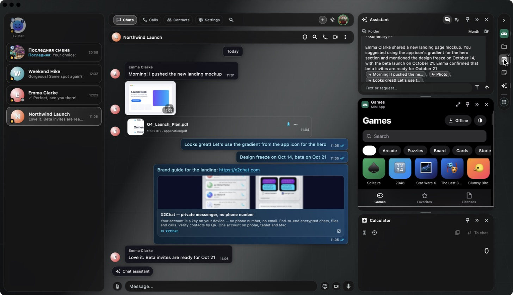 |
| **Games** — cards, arcade, puzzles, board, playable offline. | **Stack what you need** — assistant, games and calculator running together in a dock on the right. |
| 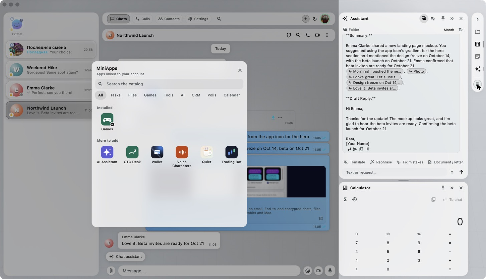 | 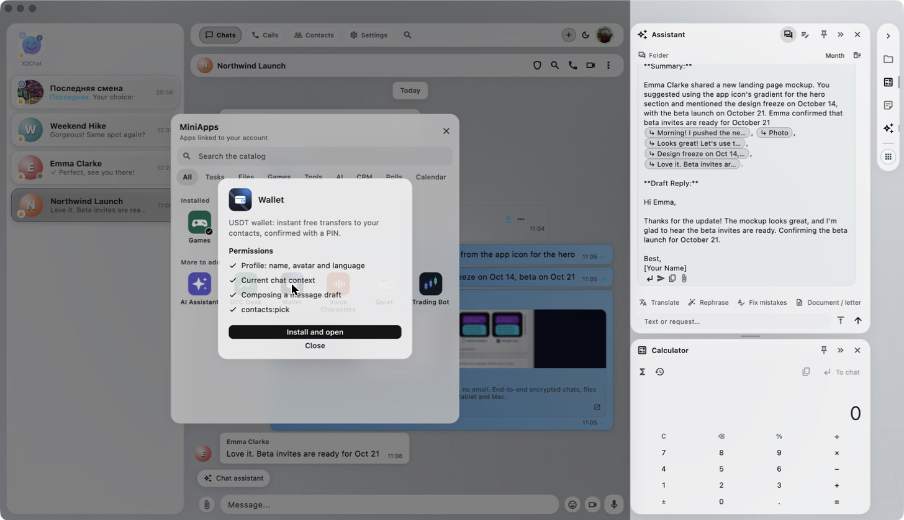 |
| **A catalogue of mini apps** — wallet, assistant, polls, CRM, tools. Install the ones you want. | **Every mini app asks first.** You see exactly what it may read before it opens. |
| 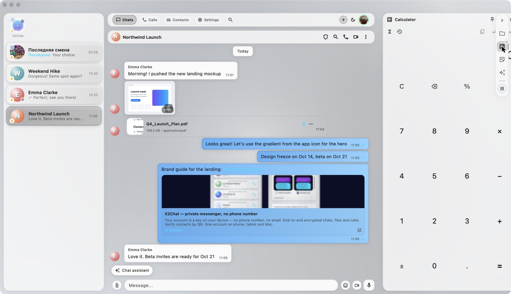 | 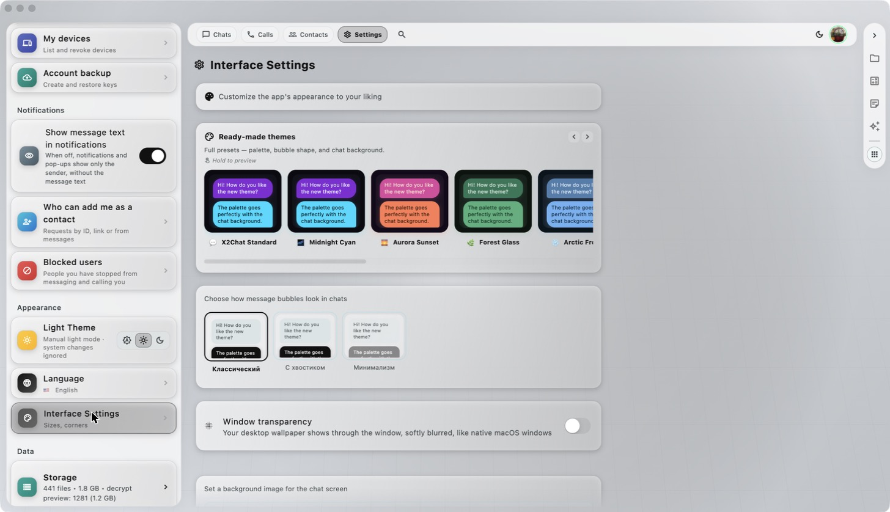 |
| **Small tools where you need them** — a calculator that drops its result straight into the chat. | **Make it yours** — full theme presets, bubble shapes, chat backgrounds, window transparency. |

## Download

| Platform | |
|---|---|
| **macOS** | [Download the app](https://x2chat.com/downloads/) · also on the Mac App Store |
| **iPhone / iPad** | [App Store](https://apps.apple.com/app/id6759472435) |
| **Android** | [APK](https://x2chat.com/downloads/x2chat-latest.apk) · Google Play · Xiaomi GetApps |
| **Windows** | [Download](https://x2chat.com/downloads/) |

## Being straight with you

We would rather you hear this from us than find it later:

- **No forward secrecy yet.** Device keys are long-lived RSA-2048; a ratchet is on the roadmap.
- **No third-party audit yet.** The [security page](https://x2chat.com/security/) is written so an auditor has something concrete to check.
- **The code is not open yet.** We are deciding what to open first — most likely the crypto layer.
- **The server sees metadata** — who talks to whom and when, like almost every messenger. We do not build social graphs and we do not sell anything.
- **Bot chats are not end-to-end encrypted**, by nature: a bot is a server.

## Questions, bugs, ideas

Open an [issue](../../issues) — we read all of them. Security reports: see [SECURITY.md](SECURITY.md).

---

© 2024–2026 X2Chat. This repository hosts the public page and releases; the application source is not published here.

